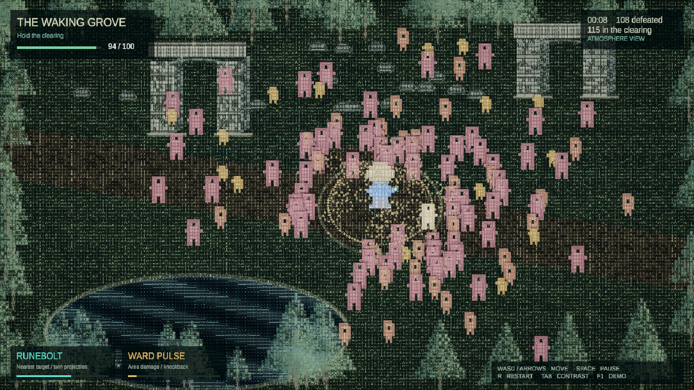
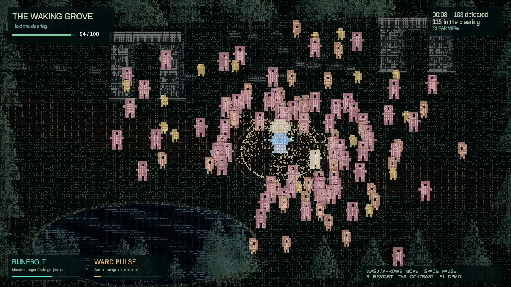

# ASCII прототип арены

**Актуальная версия:** `Builds/HeroAnimations` — [покадровые анимации героев](hero-animations.md).
[Чужак в программе, герои и Ядро](digital-world.md).
[Баланс боссов через движение и дэш](boss-balance.md).
[Разные силуэты и усложнённые боссы](boss-identity.md).
[Настройки, быстрый тест боссов и новые враги](tactical-crowd.md),
история разработки — [первые четыре блока](four-blocks-prototype.md).
15 октября пользователь разрешил развить прототип непрерывно: Arena уже
переведена на точные ASCII-матрицы с ходьбой и законченным циклом забега.
Ниже сохранено описание первой, отклонённой визуальной версии.

Прототип проверяет, насколько выразительно и читаемо работает цветная
символьная графика в бою с толпой. По поручению пользователя реализованы одна
арена, управляемый герой и две автоатаки на Unity, ECS и Zenject.
The Waking Grove — временное название сцены.

15 октября 2026 года пользователь отклонил оформление этой версии.
[Новое направление](research/ascii-survivors-character-direction.md)
использует ASCII Survivors как референс и узнаваемых составных персонажей.
Новые эскизы ещё не подключены к этой сборке.

Отдельно создан [набор двух героев](../art/sprites/roster-01-07-v1/README.md)
с четырьмя направлениями idle/walk/cast. Он импортирован в
`Assets/Art/Roster0107/`, но ArenaView пока не использует эти спрайты.
Проверка набора в headless Editor не является новым прогоном игровой сцены.

## Запуск и управление

Добавить `AsciiArena/` в Unity Hub и открыть Unity 6000.3.24f1. После
восстановления UPM-пакетов открыть `Assets/Scenes/Arena.unity` и нажать Play.
Для первого восстановления пакетов нужен доступ к Unity registry и GitHub.

| Клавиша | Действие |
| --- | --- |
| WASD или стрелки | Движение героя |
| Space | Пауза и продолжение |
| R | Новый забег |
| Tab | Приглушение окружения для читаемости боя |
| F1 | Автоматическое движение для просмотра; ручное движение отключает его |

Редакторское меню `ASCII Arena/Build Windows prototype` собирает
`AsciiArena/Builds/Windows/AsciiArena.exe`. Запускать exe вместе со всей папкой
сборки: ему нужны расположенные рядом данные и DLL. Сборки исключены из Git.
Меню `Create or refresh arena scene` пересоздаёт арену и графические ресурсы;
оно заменяет сцену, поэтому обычный запуск его не требует.

## Что реализовано

Герой перемещается по поляне с каменными арками и прудом. Вода и основания
колонн ограничивают движение. Три типа врагов различаются скоростью,
здоровьем, силуэтом и цветом; они преследуют героя и расходятся внутри толпы.
При контакте герой получает урон с кратким периодом неуязвимости.
После смерти можно перезапустить забег.

Runebolt автоматически выпускает два снаряда в направлении ближайшего
врага. Ward Pulse наносит урон вокруг героя и отбрасывает выживших врагов.
HUD показывает здоровье, время, убийства, число врагов и циклы атак.

Окружение, персонажи, вода, следы снарядов, кольца волн и искры нарисованы
символами из собственного атласа 5×7. Вода анимирована; у берега есть
стилизованное отражение героя. Палитра отделяет синего героя, тёплых врагов,
бирюзовые снаряды и золотистую волну. URP Volume добавляет лёгкий bloom,
ACES и виньетку. Это самостоятельная 2D-реализация по мотивам видеореференса;
объём и освещение ролика воспроизведены лишь условно.

## Архитектура

| Часть | Ответственность |
| --- | --- |
| `ArenaSettings` | ScriptableObject с параметрами толпы и атак |
| `ArenaInstaller` | Zenject связывает настройки, геометрию и единственную симуляцию |
| `ArenaSimulation` | Владеет Unity Entities World, сущностями и запросами; выполняет шаг боя 1/60 секунды через Zenject ITickable |
| `ArenaComponents` | ECS-данные позиции, героя, врага, здоровья и снаряда |
| `ArenaLayout` | Проекция на экран, границы, вода и обход препятствий |
| `ArenaInput` | Передаёт ввод в симуляцию через Unity Input System |
| `ArenaView` | Читает ECS-данные и строит четыре mesh-слоя символов |
| `ArenaHud` | Показывает состояние через uGUI и TextMeshPro |
| `ArenaSceneBuilder` | Создаёт сцену через Editor API и собирает Windows Player |

Папки находятся в `AsciiArena/Assets/Prototype/`, редакторские утилиты — в
`AsciiArena/Assets/Editor/`. На врагов и снаряды не создаются отдельные
GameObject. World освобождается при уничтожении Zenject-контекста.

В ECS хранится реальное состояние боя, но прототип выполняет запросы и правила
на основном потоке. Burst, Jobs, SystemBase и пространственный индекс пока
не добавлены. Разделение врагов использует квадратичный проход; лимит 180
ограничивает нагрузку. Масштаб до тысяч врагов потребует другой реализации
этого участка и профилирования. Игра работает без MCP, LLM и Unity CLI;
Pipeline используется только при разработке.

## Настройка

Настройки текущей сцены: `Assets/Prototype/Data/ArenaSettings.asset`.
Значения в сохранённом asset имеют приоритет над начальными значениями класса.

| Параметр | Значение |
| --- | --- |
| Начальная толпа / лимит | 120 / 180 |
| Приток врагов | 12 в секунду |
| Здоровье / скорость героя | 100 / 5.8 |
| Runebolt: интервал / урон одного попадания / скорость | 0.42 с / 18 / 18 |
| Ward Pulse: интервал / урон / радиус | 2.8 с / 24 / 4.8 |
| Seed | 5271 |

Настройки помогают оценить визуальную плотность и ощущения боя. Прогрессия,
подбор улучшений, метаигра, звук и баланс коммерческого выпуска ещё
не входят в этот прототип. Требования к длительности прохождения нет.

## Проверка результата

14 октября 2026 года в EditMode прошли четыре теста `AsciiArena.Tests`:
урон обеих автоатак, лимит толпы, пауза и чистый перезапуск, запрет прохода
через пруд. Их можно запустить через Unity Test Runner.

В Play Mode проверено продвижение кадров, игрового времени и позиции героя.
В одном запуске через 19.78 секунды симуляции зарегистрированы 221 убийство,
88 попаданий снарядов и 233 попадания волны; на арене было 136 врагов.
Это проверка работающих механик, а не измерение FPS или коммерческого баланса.

Development-сборка Windows x64 успешно создана штатным Unity BuildPipeline
в `AsciiArena/Builds/Windows/`. Для её передачи нужна вся папка сборки.
Отдельный Windows Player запущен: окно отвечает, в журнале запуска нет
исключений игровых скриптов. Визуальные кадры ниже получены в Editor Game View.

При последующей диагностике после сообщения пользователя о неработающем
компьютере в журнале Editor найдены повторные ошибки Direct3D 12
`failed to wait for fence` и `D3D12Fence::Wait`. Проверка запуска выше
не подтверждает длительную устойчивость. Причина сбоя всего компьютера
не установлена. Перед следующим запуском прототипа нужно отдельно
проверить графический API и устойчивость; при подготовке новых эскизов
Editor и игра не запускались.

Ниже реальные кадры Game View с HUD в одинаковом состоянии на 8.65 секунде
симуляции. Для сравнения симуляция временно остановлена через Time.timeScale;
после захвата обычное время восстановлено.

Обычный режим:

Режим повышенного контраста:

Герой и атаки выделяются цветом и размером. Обычный фон остаётся шумным при
плотной толпе; следующий художественный шаг — уменьшить частоту мелких
символов и проверить силуэты в движении с пользователем.

Происхождение графики и уведомления о сторонних лицензиях:
[реестр ассетов](assets.md).
