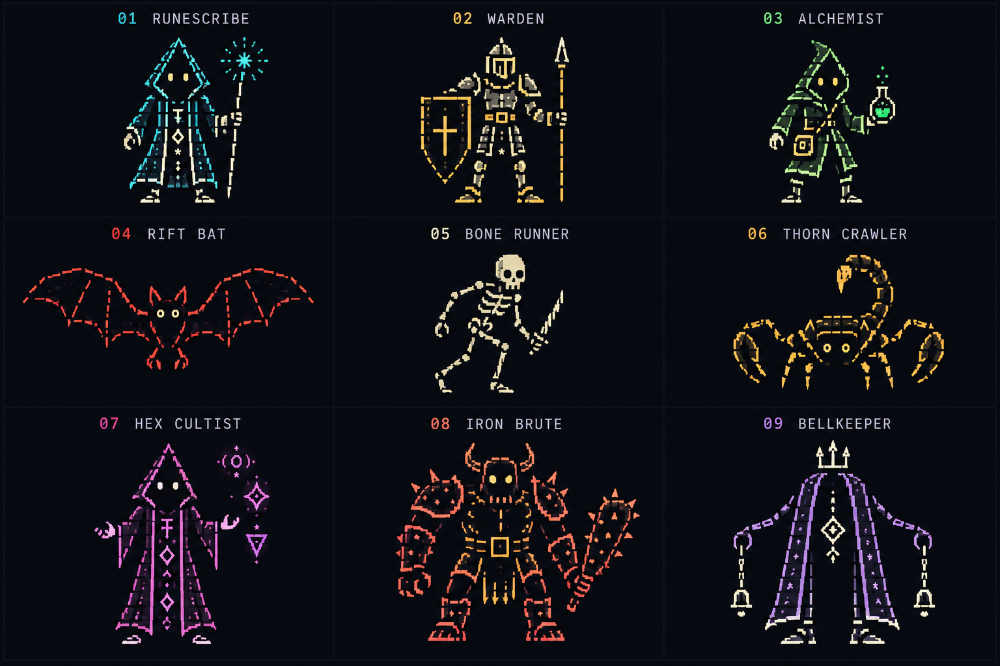
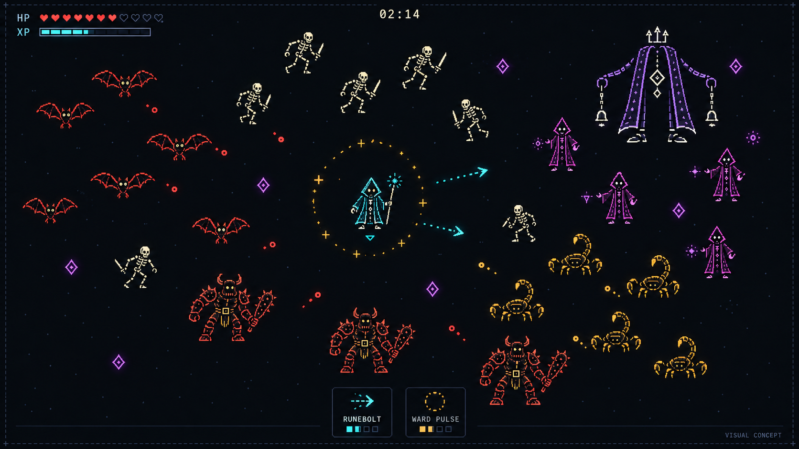

# Новое оформление и персонажи ASCII игры

Дата: 15 октября 2026 года.

## Актуально: A выбран и перенесён в Arena

Пользователь выбрал вариант A и поручил перенести оформление в игровую сцену,
не меняя механики. Текущая сборка — `AsciiArena/Builds/StyleA/AsciiArena.exe`.
Рабочие матрицы — TerminalActorArt, рендер — TerminalGlyphBatch, тот же шрифт
JetBrains Mono; HUD, палитра и ЭЛТ перенесены в игру. Вода, колонны и границы
сохраняют геометрию и видимые обозначения, потому что это игровые препятствия.
Новый задний/боковой вид героя и босс развивают выбранный вариант A.
Подробности и ограничения: [перенос в игру](../four-blocks-prototype.md).
[Запись боя](../../art/playtests/style-a/style-a-combat.gif) показывает реальную
симуляцию после ускоренного выхода на вторую минуту, с техническим автопилотом.
Ниже сохранена история сравнения до выбора; запрет переносить без выбора
к текущему поручению больше не относится.

## История: согласование двух визуальных направлений

Пользователь поручил выбрать кадры ASCII Survivors, сравнить с нашей версией
и подготовить два варианта **без изменения механик**. Выбор ещё не сделан.
Этот раздел имеет приоритет над историческими эскизами ниже, включая упоминания ног.

[Открыть сравнение](../../art/style-study-2026-10-15/index.html) ·
[Общий лист](../../art/style-study-2026-10-15/comparison.png) ·
[Источники](../../art/style-study-2026-10-15/sources.json).

### Референс и расхождения

Выбраны три официальных скриншота из [Steam](https://store.steampowered.com/app/4588220/ASCII_Survivors/):
Bone Lord (лес, маленькие противники и крупные боссы), Ice Queen (холодная
палитра) и Inferno Titan (заполнение большого силуэта символами).
Сохранены снимки их отображения в браузере 1280×720. Это материалы для
внутреннего анализа, не лицензированные ассеты нашей игры. Имя `01-field.jpg`
историческое: этот файл показывает Ice Queen. URL каждого кадра сохранён.

Наблюдения: в обычных фигурах хорошо видны отдельные знаки; большие боссы
заполнены множеством глифов. Почти чёрный фон и приглушённые деревья оставляют
приоритет ярким противникам и выстрелам. HUD компактен и моноширинен; заметны
свечение и строки развёртки. На лесном кадре герой — одиночный `@`.
Точный шрифт, параметры шейдера и размеры объектов исходной игры неизвестны.

У нашего CrtHover увеличенный bitmap-шрифт и плотные матрицы образуют почти
сплошные контуры. Большой интерфейс отдельным шрифтом и заметные границы/пруд
дают другую композицию. Поэтому усиления одного CRT недостаточно: менять
предлагается матрицы, шрифт, иерархию яркости, окружение и интерфейс вместе.
Составной герой с капюшоном — намеренное отличие от референса по требованию пользователя.

### Два варианта

| | A: фосфорный терминал | B: ритуальные плащи |
|---|---|---|
| Матрицы | 3–4 строки, короткие группы видимых знаков | 5–6 строк, заполнение `# : %` |
| Размер шрифта в 1080p | 22 для фигур | 17 для фигур |
| Палитра | Светлый герой; зелёный, янтарный, фиолетовый для ролей | Светлый бирюзовый герой; медный и приглушённый лиловый |
| Окружение | Тёмно-зелёные хвойные деревья | Тёмные ветвистые деревья и руны |
| ЭЛТ | Более заметный bloom и строки | Мягче bloom, слабее строки и изгиб |
| Движение | Лёгкое парение целой фигуры | Парение и небольшое смещение нижних строк плаща |
| Компромисс | Меньше подробностей костюма | Детали и близкие цвета хуже разделяются в тесной группе |

Рекомендация — **A** для приближения к референсу. Это художественная оценка
по кадрам, не подтверждённый плейтест. B сохраняет больший акцент на костюмах.
Не переносить ни один вариант в Arena до выбора пользователя.

### Что действительно сделано и проверено

- Создана отдельная сцена `AsciiArena/Assets/StyleStudy/StyleStudy.unity`
  с собственными копиями URP renderer/pipeline и Volume, без изменения основных.
- Одинаковая постановка A/B: 1920×1080, герой и 24 врага трёх ролей, одинаковые
  точки размещения и условный RuneBolt. Нет ECS-симуляции боя, AI, урона или
  новой экономики. Текстовые значения HUD — иллюстрация.
- Настоящие символы JetBrains Mono Medium, статический TMP ASCII-атлас,
  разрешённая коммерческая лицензия SIL OFL 1.1 с сохранённым текстом.
  Растеризация SDF — воспроизводимый вариант, не утверждение о технологии референса.
- Сборка `AsciiArena/Builds/StyleStudy/StyleStudy.exe`: 1/2 — вариант,
  R — лист персонажей, F2 — CRT, Space — пауза, Esc — выход.
- Реальные GPU-кадры Direct3D11: сцена с CRT/без CRT, лист персонажей 1×/3×,
  24 кадра парения для каждого варианта. GIF 12 fps, 2 секунды, 1280×720;
  частота GIF не является замером FPS игры. Оригинальные PNG — 1920×1080.
- Сборка успешна, ошибок сборки 0. 69 предупреждений сохранены в
  `evidence/build.messages.txt` (включая тестовые Resources Extenject и
  отсутствие RuntimePipelineConfig). Во время захвата журнал ошибок пуст,
  кадры продвинулись с 3 до 57; при завершении Player есть предупреждение
  Unity об освобождении ComputeBuffer сборщиком мусора. Это не чистый
  production-билд и не проверка устойчивости длительной игры.
- SHA-256 всех 106 файлов в исходных Prototype, Scenes, Settings,
  ProjectSettings и Packages совпадает с исходным снимком. Проверка сохранена
  в `evidence/gameplay-freeze-check.json`. Геймплейные тесты не перезапускались:
  игровые правила не менялись.

Скриншот CrtHover взят из предыдущей проверенной сборки; скриншоты Steam
показывают другие игровые ситуации. Только A/B являются контролируемой
парой с одинаковой постановкой. Сравнение не доказывает читаемость в полном
бою: после выбора понадобятся проба в Arena и проверка перекрытий/эффектов.

Воспроизведение: Editor `StyleStudyBuilder.Prepare()` создаёт ресурсы,
`StyleStudyBuilder.Build()` собирает отдельный Player. Ключ Player
`--study-capture <absolute-directory>` экспортирует кадры и отчёт;
`tools/style-study/package.py` собирает GIF, сравнительный лист и проверяет
замороженные файлы. Для скрипта нужен Pillow. Сохранённые кадры не являются
готовыми четырёхнаправленными анимациями персонажей.

## История раннего оформления

Пользователю не понравилась графика первого прототипа. Он выбрал
[ASCII Survivors](https://store.steampowered.com/app/4588220/ASCII_Survivors/)
как новый референс: тёмное поле, читаемые противники и подходящая под
survivor-like подача. Герой должен выглядеть персонажем, а не знаком `@`.
Первый вариант оформления не развиваем как выбранное направление.
Unity, ECS и Zenject сохраняются в техническом каркасе прототипа.

## Принципы оформления

На просмотренных кадрах трейлера и скриншотах референса обычные враги
состоят из небольших групп символов, боссы заметно крупнее, а окружение
приглушено. В собственном варианте используем свободное тёмное пространство,
простые силуэты и короткие эффекты с чётким центром.

Персонаж должен узнаваться по форме головы, тела, оружия и позе. Цвет
поддерживает различимость; одной перекраски одинаковой фигуры недостаточно.
Летучая мышь широкая, скелет узкий и с длинными ногами, скорпион низкий,
культист высокий, тяжёлый враг широкоплечий, босс крупный и с пустым центром.
На герое заметны капюшон, глаза, ноги и посох. Фон не заполняем сплошной
символьной травой. Вспышки и свечение не должны перекрывать силуэты.

Для точного ASCII-рендера следующий технический шаг — перенести выбранный
эскиз в фиксированную сетку глифов и проверить его в реальном размере.
Изображения ниже местами используют рисунок из фрагментов знаков;
это эскизы формы и палитры, а не готовая сетка символов.

## Первые персонажи

Предлагаемые имена, роли и состав набора пока служат выбору оформления.
Это не утверждённый объём контента или набор новых игровых механик.

| Персонаж | Образ и различимость |
| --- | --- |
| Писец рун | Бирюзовый капюшон, светлые глаза, посох со звездой; первый кандидат на героя |
| Страж | Квадратный шлем, большой щит и узкое копьё; светлая броня с золотом |
| Алхимик | Зелёный короткий плащ и вынесенная в сторону колба |
| Разломная мышь | Красные широкие крылья и маленькое тело |
| Костяной бегун | Светлый череп, раздельные рёбра и длинные согнутые ноги |
| Терновый ползун | Янтарный скорпион с клешнями и поднятым хвостом |
| Культист | Пурпурный треугольный капюшон и длинная раскрытая мантия |
| Железный громила | Коралловые широкие плечи, рога и тяжёлая дубина |
| Звонарь | Фиолетовая колоколообразная мантия, подвесная руна и два колокола |

Оба изображения созданы встроенным `image_gen` с применением skill
`imagegen`. Второе использует первый лист как референс собственных персонажей.
Полные запросы и происхождение находятся рядом с PNG в
`art/concepts/ascii-survivors-v2/`. Чужие игровые ассеты не импортированы.
Концепт боя не является кадром из Unity и не подтверждает читаемость
движущейся толпы или качество анимаций. Эскизы ещё не подключены к игре.

## Найденные skills

Официальный curated-каталог `openai/skills` проверен через `skill-installer`;
отдельного skill для спрайтов или ASCII-арта в полученном списке нет.

Среди сторонних кандидатов найден
[Agent Sprite Forge](https://github.com/0x0funky/agent-sprite-forge), в частности
[generate2dsprite](https://github.com/0x0funky/agent-sprite-forge/blob/main/skills/generate2dsprite/SKILL.md).
Текущая версия описывает процесс от основного изображения персонажа до
анимаций, очистки фона, проверки масштаба и упаковки атласов. Это кандидат
для растровых спрайтов; точный ASCII-рендер он сам по себе не обеспечивает.
Первоначально он не был установлен. Позже 15 октября пользователь поручил
подключить skill и сравнить концепты с ним и без него. Установлены
`generate2dsprite` и `generate2dmedia`; создано восемь эскизов по одному заданию.
[Поиск альтернатив, условия и результаты сравнения](sprite-skills-comparison.md)
сохранены отдельно. Полный анимационный процесс пока не проверен.

Для текущих эскизов хватило доступного `imagegen`. При переносе растровых
спрайтов в Unity доступны skills `unity:sprite-editor`,
`unity:manage-sprite-atlas` и `unity:2d-pixel-perfect`. Они помогают импортировать
и выводить графику; художественное качество проверяем по самим изображениям.

## Коммерческая оценка

На проверенной странице Steam указаны четыре пользовательских отзыва.
Это не позволяет установить выручку игры или причину её результатов.
Поэтому не отвергаем графическое направление из-за предположения о продажах;
интерес к нашей игре потребуется проверять отдельно от оценки оформления.
